<!-- Garden header -->

  

<h1 align="center">Hi, I'm Taa 🌱</h1>

  <i>Always learning, always blooming.</i>

  Exploring AI tools, experimenting with workflows,
  and learning by building things along the way.

---

## 🌿 My Little Garden

I'm curious about how AI tools can make everyday work
more creative, connected, and useful.

I enjoy trying new tools, figuring out how they work,
and turning tutorials into small hands-on experiments.

I don't have everything figured out yet — and that's part
of the fun.

## 🧰 Tools I've Explored

  
  
  
  
  
  

## 🌱 Currently Exploring

- **AI workflows** — connecting tools and experimenting with automation.
- **Tool integration** — learning how MCP and connected tools work.
- **Learning by building** — following tutorials, troubleshooting, and improving step by step.

These are my learning interests and hands-on explorations,
not a list of technologies I claim to master.

## 🐍 Contributions

  

  

---

<!-- ============ Footer (a cat lives here) ============ -->

  <picture>
    <source media="(prefers-color-scheme: dark)" srcset="garden-footer-night.svg" />
    
  </picture>

  
    Growing at my own pace, one experiment at a time. 🌷
  

  
    The sky above follows the real forecast and the garden follows the season —
    powered by <a href="https://github.com/yuki4266/living-scene">living-scene</a>.
    Want one? <a href="https://github.com/yuki4266/living-scene-template/generate">Use the template</a>.
  

